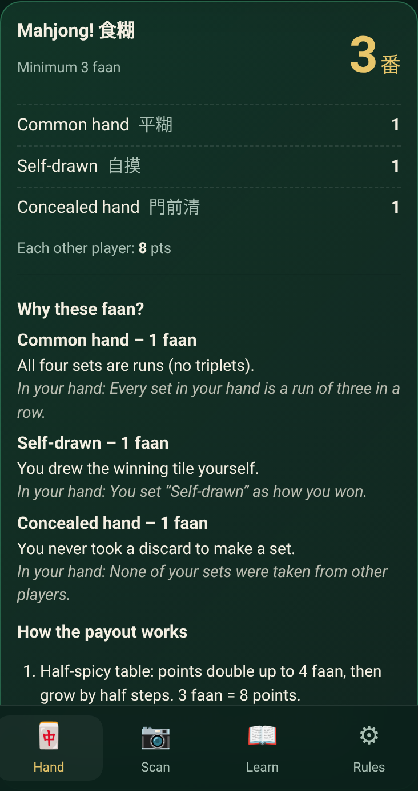
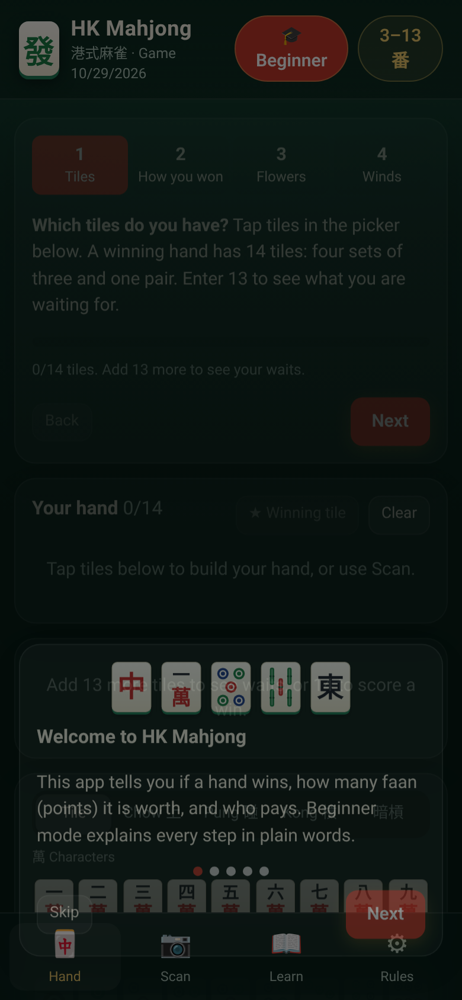
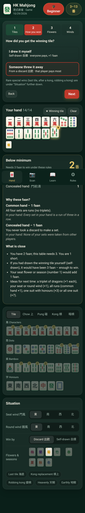
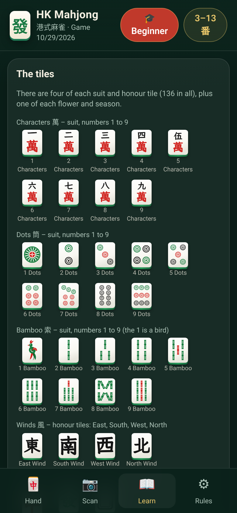
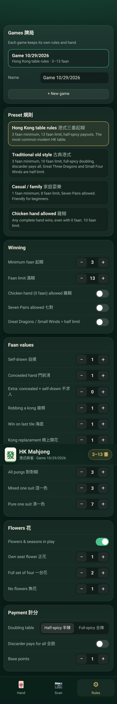
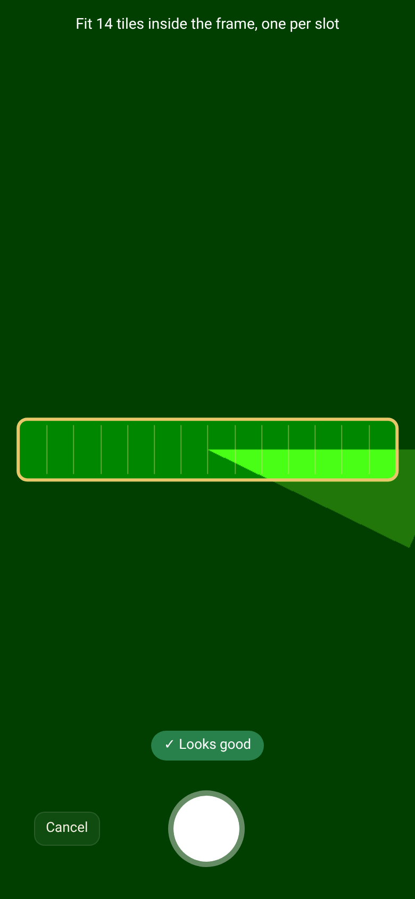
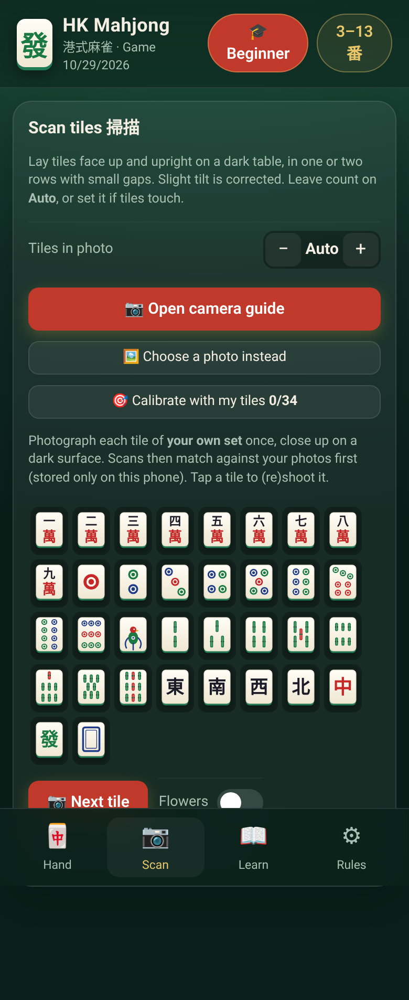

# HK Mahjong 港式麻雀

A free, open-source **Hong Kong style mahjong helper** for Android and iPhone. It's a Progressive Web App: open it in the phone browser, tap **Add to Home Screen**, and it works like a native app, offline too.

<p>
  
</p>

## Features
- **Hand entry.** Tap tiles to build a 13- or 14-tile hand. Add exposed chows (上), pungs (碰), kongs (明槓) and concealed kongs (暗槓), plus flowers and seasons, seat wind, round wind, and whether you won by self-draw (自摸) or on a discard.
- **Faan calculator.** Uses Hong Kong rules: four sets and a pair, the minimum faan to win (起糊) and the limit (滿糊). You see a breakdown of every pattern that scored, plus the payout.
- **Waiting tiles (聽牌).** With 13 tiles, the app lists every tile that completes the hand and what each one is worth.
- **Rule presets and house rules.** Each game saves its own rule set. You can pick a preset and then adjust any rule.
- **Scan (experimental).** Photograph a row of tiles. The app reads them and you check each one before using the hand.

## Rule presets
| Preset | Min | Limit | Notes |
|---|---|---|---|
| Hong Kong table rules 港式三番起糊 | 3 | 13 | Half-spicy (半辣) payouts, half-shooter (半銃) |
| Traditional old style 古典港式 | 3 | 10 | Full-spicy (全辣) doubling, discarder pays all (全銃), Great Three Dragons / Small Four Winds are half-limit, +1 for a fully concealed self-draw (不求人) |
| Casual / family 家庭耍樂 | 1 | 8 | Seven Pairs allowed |
| Chicken hand allowed 雞糊 | 0 | 10 | Any complete hand wins |

Adjustable rules: minimum faan, limit, Seven Pairs (on/off and its faan), chicken hand, half-limit hands, faan for self-drawn, concealed, 不求人, robbing a kong, last tile, kong replacement, common hand, all pungs, mixed and pure one suit, flowers in play or not, own flower, four-flower set, no-flower bonus, half-spicy or full-spicy table, discarder pays all, and base points.

### Faan table (default values)
| Pattern | Faan |
|---|---|
| Common hand 平糊 (all chows) | 1 |
| All pungs 對對糊 | 3 |
| Mixed one suit 混一色 | 3 |
| Pure one suit 清一色 | 7 |
| Mixed terminals 混么九 | 1 |
| Dragon pung 中/發/白 | 1 each |
| Seat wind / round wind pung 門風/圈風 | 1 each |
| Small three dragons 小三元 | 5 |
| Great three dragons 大三元 | 8 (or half limit) |
| Small four winds 小四喜 | 6 (or half limit) |
| Self-drawn 自摸, concealed 門前清, no flowers 無花, seat flower 正花 | 1 |
| Full flower or season set 一台花 | 2 |
| Last tile 海底撈月, kong replacement 槓上開花, robbing a kong 搶槓 | 1 |
| Seven pairs 七對 (house rule, off by default) | 4 |
| **Limit hands:** Thirteen Orphans 十三么, Great Four Winds 大四喜, All Honours 字一色, All Terminals 清么九, Four Kongs 十八羅漢, Four Concealed Pungs 坎坎糊, Nine Gates 九子連環, Heavenly 天糊 / Earthly 地糊, All Eight Flowers 八仙過海 | Limit |

When a hand can be split into sets in more than one way, the app scores the split worth the most. If you win on a discard, the set that the discarded tile completes counts as exposed. So four concealed pungs is a limit hand only when you self-draw or win on the pair.

Payment tables: **half-spicy** pays 1, 2, 4, 8, 16, 24, 32, 48, 64, 96, 128… points. **Full-spicy** doubles with every faan. On a self-draw, each opponent pays the table amount. On a discard win under 半銃, the discarder pays the full amount and each other player pays half; under 全銃, the discarder pays double.

Hong Kong scoring varies a lot from table to table. If your table plays differently, change the rules in **Rules**, or open an issue.

## Beginner mode

On by default (toggle 🎓 Beginner in the header). It adds:

- A short first-run tutorial (shown once).
- A guided four-step card on the Hand tab: tiles → how you won → flowers → winds.
- Under each result: a plain-language explanation of every faan item and why it applies to *this* hand, the payout worked out step by step, and for hands below the minimum a "What is close" list computed by re-scoring the hand (for example "if you had drawn it yourself it would be 3 faan – enough").
- A **Learn** tab: every tile with its name, how a hand wins, the main scoring patterns with tile pictures, and a glossary.
- An ⓘ tooltip on every rule setting.

    

## Scanning

  

- **Camera guide**: live view with a frame and one slot per tile, warnings for dark, blurry or glare-filled images. Or choose a photo.
- **Segmentation**: finds tiles and rows, straightens mild tilt (about ±20°), counts tiles automatically.
- **AI model**: a small on-device CNN (426k parameters, 430 KB int8, pure TypeScript runtime, works offline). Blended with template matching; calibrating with your own tiles improves it.
- **Calibration**: photograph your own set once per tile face.
- **Checks**: flags too many tiles, duplicates beyond four, wrong counts and non-winning reads, with one-tap fixes from the model's next-best guesses. You always review before using a scan.

Measured on 119 held-out photos (see `training/README.md`):

| Test | AI model | Template only |
|---|---|---|
| Tight crop (PyTorch) | 95.8% top-1, 98.3% top-3 | – |
| Full app pipeline | 85.7% top-1, 89.1% top-3 | 25.2% / 37.0% |
| 30 composite rows, tiles right | 89.3% (11/30 hands fully right) | 23.3% |

Limits: small test set from the same source as the training data; composite rows are not real table photos; tiles must be upright; the camera guide is untested on real phones. Treat a scan as a first draft.

**Dataset**: [Camerash/mahjong-dataset](https://github.com/Camerash/mahjong-dataset) (MIT, 628 images, 42 classes) plus this app's own tile drawings. The images were scraped from the web, so only the trained weights are shipped; images are not in this repo. `training/` has the scripts to reproduce.

## Development
```bash
npm install
npm run dev      # local dev server
npm test         # unit tests (Vitest)
npm run build    # static build in dist/
```
Built with Vite, React and TypeScript, plus vite-plugin-pwa for the service worker and manifest. The scoring engine (`src/engine/`) has no dependencies, so other projects can reuse it.

### Deploy to GitHub Pages
The build uses relative paths, so `dist/` works from any sub-path. Push it with an action such as `actions/deploy-pages`, or any static host.

## Licence
MIT. See [LICENSE](LICENSE).

## Tiles (v2)

- **Hand-drawn SVG tiles** in the classic Hong Kong melamine style: ivory faces, a green bamboo-grain back, red and green circles, segmented bamboo, a bird on 1 Bamboo, and flowers and seasons with numbered corners. See [`docs/tileset.png`](docs/tileset.png).
- **Same tiles on every phone.** The glyphs are SVG paths from **LXGW WenKai TC** (SIL Open Font License 1.1); see `src/glyphs.ts`.
- **Every drawing fits the face.** Each drawing is centred and fills 82 % of the ivory face, with at least an 8 % margin. `tests/tileMargins.test.ts` renders all 42 tiles at every size the app uses and fails on a drawing that is too big, too small or off-centre. After you edit a drawing, run `GEN_BOUNDS=1 npx vite-node scripts/tile-bounds.mjs`.
- **The scanner was retrained** on the new drawings; see `training/README.md`.
