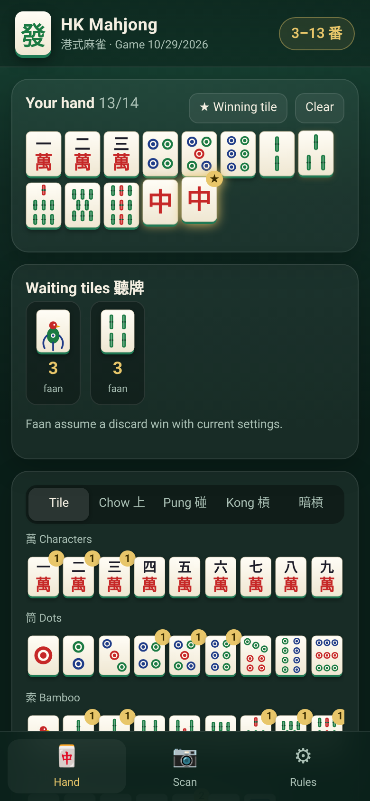
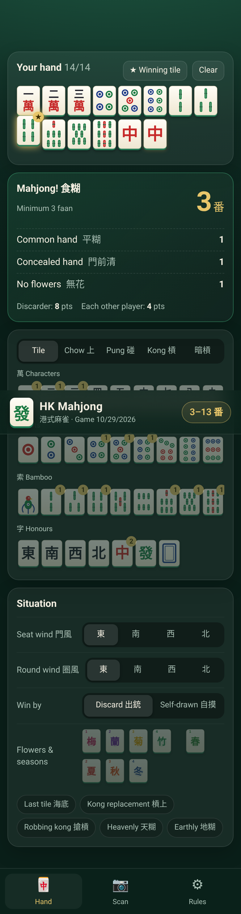
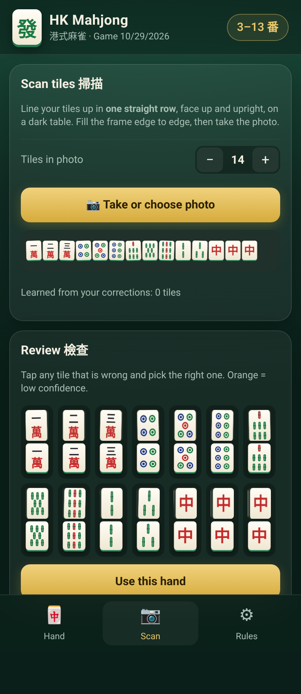

# HK Mahjong 港式麻雀

A free, open-source **Hong Kong style mahjong helper** for Android and iPhone. It's a Progressive Web App: open it in the phone browser, tap **Add to Home Screen**, and it works like a native app, offline too.

<p>
  
</p>

## Features
- **Hand entry.** Tap tiles to build a 13- or 14-tile hand. Add exposed chows (上), pungs (碰), kongs (明槓) and concealed kongs (暗槓), plus flowers and seasons, seat wind, round wind, and whether you won by self-draw (自摸) or on a discard.
- **Faan calculator.** Uses Hong Kong rules: four sets and a pair, the minimum faan to win (起糊) and the limit (滿糊). You see a breakdown of every pattern that scored, plus the payout.
- **Waiting tiles (聽牌).** With 13 tiles, the app lists every tile that completes the hand and what each one is worth.
- **Rule presets and house rules.** Each game saves its own rule set. You can pick a preset and then adjust any rule.
- **Scan (experimental).** Photograph a row of tiles. The app reads them and you check each one before using the hand.

## Rule presets
| Preset | Min | Limit | Notes |
|---|---|---|---|
| Hong Kong table rules 港式三番起糊 | 3 | 13 | Half-spicy (半辣) payouts, half-shooter (半銃) |
| Traditional old style 古典港式 | 3 | 10 | Full-spicy (全辣) doubling, discarder pays all (全銃), Great Three Dragons / Small Four Winds are half-limit, +1 for a fully concealed self-draw (不求人) |
| Casual / family 家庭耍樂 | 1 | 8 | Seven Pairs allowed |
| Chicken hand allowed 雞糊 | 0 | 10 | Any complete hand wins |

Adjustable rules: minimum faan, limit, Seven Pairs (on/off and its faan), chicken hand, half-limit hands, faan for self-drawn, concealed, 不求人, robbing a kong, last tile, kong replacement, common hand, all pungs, mixed and pure one suit, flowers in play or not, own flower, four-flower set, no-flower bonus, half-spicy or full-spicy table, discarder pays all, and base points.

### Faan table (default values)
| Pattern | Faan |
|---|---|
| Common hand 平糊 (all chows) | 1 |
| All pungs 對對糊 | 3 |
| Mixed one suit 混一色 | 3 |
| Pure one suit 清一色 | 7 |
| Mixed terminals 混么九 | 1 |
| Dragon pung 中/發/白 | 1 each |
| Seat wind / round wind pung 門風/圈風 | 1 each |
| Small three dragons 小三元 | 5 |
| Great three dragons 大三元 | 8 (or half limit) |
| Small four winds 小四喜 | 6 (or half limit) |
| Self-drawn 自摸, concealed 門前清, no flowers 無花, seat flower 正花 | 1 |
| Full flower or season set 一台花 | 2 |
| Last tile 海底撈月, kong replacement 槓上開花, robbing a kong 搶槓 | 1 |
| Seven pairs 七對 (house rule, off by default) | 4 |
| **Limit hands:** Thirteen Orphans 十三么, Great Four Winds 大四喜, All Honours 字一色, All Terminals 清么九, Four Kongs 十八羅漢, Four Concealed Pungs 坎坎糊, Nine Gates 九子連環, Heavenly 天糊 / Earthly 地糊, All Eight Flowers 八仙過海 | Limit |

When a hand can be split into sets in more than one way, the app scores the split worth the most. If you win on a discard, the set that the discarded tile completes counts as exposed. So four concealed pungs is a limit hand only when you self-draw or win on the pair.

Payment tables: **half-spicy** pays 1, 2, 4, 8, 16, 24, 32, 48, 64, 96, 128… points. **Full-spicy** doubles with every faan. On a self-draw, each opponent pays the table amount. On a discard win under 半銃, the discarder pays the full amount and each other player pays half; under 全銃, the discarder pays double.

Hong Kong scoring varies a lot from table to table. If your table plays differently, change the rules in **Rules**, or open an issue.

## Scanning: what it can and can't do
Be realistic about scanning. This is a first version.

- **How it works:** everything runs on your phone and no image is uploaded. The app looks for the bright tile faces in the photo and splits that area into the number of tiles you set. It then compares each tile against built-in drawings of every tile, using shape matching plus a colour check.
- **Works well:** one straight row of tiles, face up and upright, on a dark plain background, evenly lit, filling the frame. With clean images (tested with rendered tiles) it reads all 14 correctly.
- **Weak spots:** real tile sets look different from the built-in drawings, so expect mistakes with real photos. Dots, bamboo and characters of the same suit get confused most, and so does the 1 Bamboo bird. Tilted, overlapping or stacked tiles, multiple rows, glare, and busy backgrounds all cause problems. Flowers and declared melds are not scanned.
- **Gets better as you use it:** you check every tile before the hand is used. Tiles you correct, and tiles the app wasn't sure about, are saved on your phone as examples, so later scans of **your own** tile set get more accurate. You can reset these examples at any time.
- **Planned:** a trained on-device model (e.g. TensorFlow.js or ONNX) using a labelled dataset of real tile photos, and automatic detection of each tile.

## Development
```bash
npm install
npm run dev      # local dev server
npm test         # unit tests (Vitest)
npm run build    # static build in dist/
```
Built with Vite, React and TypeScript, plus vite-plugin-pwa for the service worker and manifest. The scoring engine (`src/engine/`) has no dependencies, so other projects can reuse it.

### Deploy to GitHub Pages
The build uses relative paths, so `dist/` works from any sub-path. Push it with an action such as `actions/deploy-pages`, or any static host.

## Licence
MIT. See [LICENSE](LICENSE).
